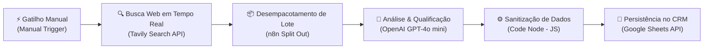

# 🚀 Lead Scout Agent — Prospecção B2B Inteligente com IA

> Agente autônomo de prospecção comercial e qualificação de leads desenvolvido de ponta a ponta para resolver uma dor real de negócios: a identificação e abordagem consultiva de clientes de alto valor na internet.

---

## 📌 Visão Geral do Projeto

A prospecção manual de clientes é um dos processos mais caros e lentos para quem vende serviços digitais e tecnologia. 

O **Lead Scout Agent** foi projetado para automatizar todo esse ciclo:
1. Pesquisa empresas reais na internet com base no nicho e na cidade desejados.
2. Analisa a presença digital de cada empresa utilizando um modelo de linguagem (LLM).
3. Atribui uma nota de oportunidade comercial (Score de 1 a 10).
4. Sugere o serviço ideal para o negócio (Site Moderno, Chatbot de Atendimento ou Automação).
5. Escreve uma abordagem comercial personalizada pronta para envio no WhatsApp.
6. Registra tudo estruturado em um CRM (Google Sheets).

**Resultado mensurável:** Redução de mais de **95% do tempo gasto em prospecção manual** (de 3 horas para 4 segundos por lote de leads).

---

## 🛠️ Arquitetura da Solução



---

## 💻 Tecnologias & Ferramentas Utilizadas

* **Orquestrador de Fluxos:** [n8n](https://n8n.io) (n8n Cloud)
* **API de Busca Inteligente:** [Tavily Search API](https://tavily.com) (específica para agentes de IA)
* **Modelo de Linguagem (LLM):** OpenAI `gpt-4o-mini`
* **Engenharia de Prompt:** Saída estrita em JSON estruturado com persona de consultor comercial
* **Tratamento de Dados:** JavaScript nativo no n8n (tratamento de erros e parsing)
* **Armazenamento / CRM:** Google Sheets integrado via OAuth2

---

## 🧠 Engenharia de Prompt e Saída Estruturada

O agente utiliza uma **System Message** com diretrizes estritas de consultoria B2B, garantindo que o modelo nunca retorne respostas conversacionais abertas, mas sim um objeto JSON padronizado:

```json
{
  "score": 9,
  "justificativa": "A empresa possui grande volume de clientes e múltiplos polos, necessitando de automação no atendimento.",
  "servico_recomendado": "Site Moderno e Chatbot de Atendimento",
  "abordagem": "Olá! Notei que a comunicação com seus clientes pode ser otimizada com um chatbot integrado..."
}
```

---

## 📊 Demonstração dos Resultados

* **Planilha CRM em Produção:** [Acessar Planilha de Demonstração](https://docs.google.com/spreadsheets/d/1Dv88xEpsRgp3bL0anGUIsOzwOKn-D6cNad2oCuV1jhE/edit?usp=sharing)


---

## 🗺️ Roadmap de Evoluções Técnicas (Visão AI Engineer)

Este projeto foi concebido sob a filosofia de entregar um **MVP ágil e funcional** primeiro, com arquitetura preparada para evolução técnica:

- [ ] **v2.0:** Gatilho via Webhook público e integração com formulário frontend (Lovable/v0.dev).
- [ ] **v2.1:** Consulta automática de CNPJ e dados de sócios via BrasilAPI para enriquecimento cadastral.
- [ ] **v3.0:** Migração da persistência para banco relacional em nuvem (**Supabase / PostgreSQL**).
- [ ] **v4.0:** Pipeline avançado em Python (**LangGraph**) com deduplicação vetorial de leads via embeddings (**pgvector**).

---

## 👨‍💻 Autor

**Antonio Carlos**  
*Desenvolvedor & AI Builder focado em soluções que geram impacto e resultado de negócio com Inteligência Artificial.*
